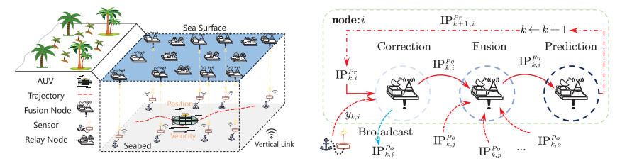
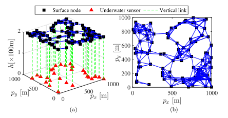
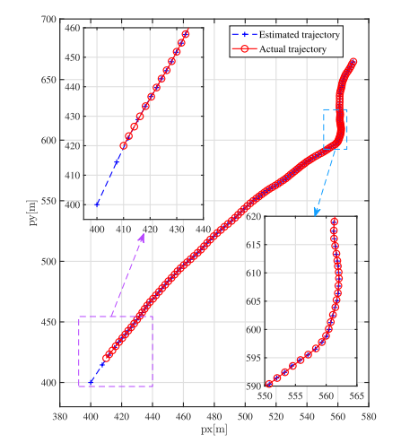
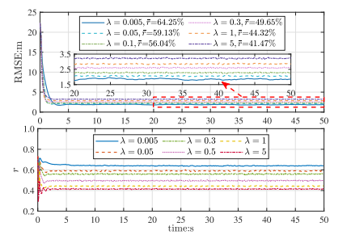
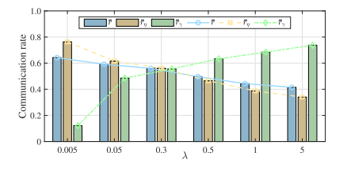
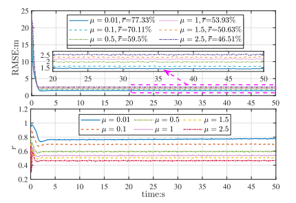
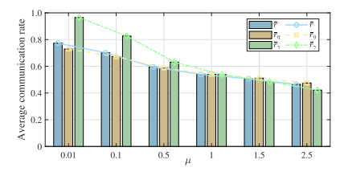

# Water Sound Communication: A New Method for Distributed State Estimation of Dual-Event-Triggered Communication in Underwater Internet of Things [with MATLAB Code]

Towards Underwater Internet of Things: A Novel Method for Distributed State Estimation with Dual Event-Triggered Communication
This study focuses on the distributed state estimation problem in underwater Internet of Things (IoUT) systems, which utilize a hybrid topology structure of underwater acoustic wireless sensors and surface wireless networks. Distributed state estimation (DSE) leverages noise measurements and local neighborhood information to reconstruct system states, but is limited by energy and communication bandwidth resources. To address this, this paper designs two types of event-triggered strategies for two typical wireless communication channels, transmitting filtering local posterior information and sensor measurement data respectively. Based on the Covariance Intersection (CI) fusion criterion and event-triggered strategies, we propose a recursive form of a consistent distributed state estimator with dual event-triggered communication; under the constraints of network connectivity and collective observability of the system, we derive an average squared error consensus upper bound for each node's estimation error. Finally, through underwater target tracking simulations, we validate the effectiveness of the proposed method.
Introduction: The rapid development of wireless communication and smart device technology has driven the widespread adoption of the Internet of Things (IoT). As a core support for intelligent marine applications, the Underwater Internet of Things (IoUT) has been applied in scenarios such as marine biomonitoring, search and rescue, and underwater intelligence gathering. IoUT consists of a large number of underwater wireless sensor nodes and surface nodes, enabling integrated communication between underwater devices and land systems. Consistent distributed state estimation (DSE) is a key technology for completing complex perception tasks.
Traditional DSE requires nodes to broadcast data every time slot, which is difficult to implement in IoUT networks with limited communication bandwidth and energy due to their remote deployment environments and challenging power supply. Event-triggered communication can effectively reduce transmission frequency, becoming a necessity for energy and bandwidth-constrained networks.
The existing DSE methods are rarely adapted to the hybrid network of underwater acoustic sensors and surface wireless nodes. They have not fully considered the transmission limitations of underwater sensors—high energy consumption, low data rate, and strong environmental interference compared to surface nodes which can be more easily recharged. Therefore, it is urgent to design exclusive event-triggered transmission strategies for both types of communication channels to address the performance and stability issues of DSE under dual event triggering mechanisms.
Based on this, this paper focuses on the dual event-triggered DSE problem in IoUT environment for linear time-varying Gaussian systems. Two types of event-triggering strategies are designed, a distributed estimation algorithm with CI criterion is constructed, and strict stability analysis is completed to provide reliable technical support for cross-media tasks such as underwater target tracking.
Method Introduction: The core method in this paper revolves around the design of a dual-event trigger strategy and the construction of a consistent distributed state estimator, which is divided into three steps.
1. System and Network Modeling: The IoUT topology is modeled as a directed acyclic graph, distinguishing between underwater sensors, surface integrated nodes, and relay nodes. The target motion state is described using a discrete linear stochastic differential equation, with Gaussian observation noise included in the measurement model. Additionally, three assumptions are set: system reversibility, strong connectivity of the network, and bounded mean square noise.
2. Design of Triggered Communication Strategy for Underwater Acoustic Channels
Surface Water Wireless Channel Event Triggering: Design a deterministic trigger mechanism to determine whether to broadcast posterior information based on the error norms of current estimation and historical prediction estimation, thereby reducing redundant communication among surface node.
3. The distributed state estimator is constructed based on the information form Kalman filter (IFKF), completing the three-step recursive iteration of correction, fusion and prediction:
1  
Correction step: Update the local posterior information pair based on the event triggering result.
2  
Fusion step: Utilize the Covariance Intersection (CI) criterion to integrate local posterior information with information triggered by neighboring nodes.
3  
4. Stability analysis, leveraging the Perron-Frobenius theorem and Lyapunov function, demonstrates that under network connectivity and system collective observability constraints, the estimation error of the proposed estimator is uniformly bounded in mean square, ensuring the algorithm's stability and reliability.
Conclusion This paper successfully solves the distributed state estimation problem under dual event triggering mechanism in IoT hybrid network, and the core conclusions are as follows:
1  
The proposed dual-event triggering strategy can precisely adapt to the characteristics of underwater acoustic and surface wireless channels. At a communication rate of about 48.80%, it estimates with an accuracy that is up to 26.82% higher than existing methods.
2  
Strictly derived and proved the mean square consistent upper bound of estimation error, the algorithm has theoretical stability.
3  
Parameters λ, ℏ, ψ can adjust the surface network communication rate, μ can synchronize the communication rates between underwater and surface, and when actual deployment, it can balance the energy saving in underwater and the estimation accuracy.
4  
The simulation results show that this method achieves higher estimation accuracy under the same communication rate, reduces overall energy consumption under the same accuracy, especially significantly saves the energy consumption of underwater acoustic sensors, and is suitable for actual application scenarios in IoUT.
In the future, we can further develop energy-aware event triggering transmission strategies based on the water surface node solar energy collection model, expanding to more marine tasks such as cross-medium target detection, positioning, and tracking.

## Images

<!-- PAYMENT_BLOCK -->

## Get this dataset

- Payment link (Stripe): [Buy now](https://buy.stripe.com/3cs8yP7sY87d0vu9AB)
- Payment QR code: 

<!-- /PAYMENT_BLOCK -->
